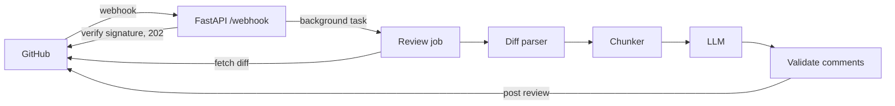

# nitpick

An LLM-powered pull request reviewer. When a pull request is opened or
updated, nitpick reads the diff, asks an LLM to look for bugs, security
issues, performance problems and readability issues, and posts the
findings back to GitHub as inline review comments.

## Why

Small teams and solo developers often merge code that nobody else has
read. nitpick gives every PR a fast first pass so human reviewers can
spend their time on design questions instead of obvious mistakes.

## How it works



| Module | Responsibility |
| --- | --- |
| `diff_parser.py` | Parse unified diff into files, hunks and line numbers |
| `chunker.py` | Filter, prioritise and split files into LLM-sized chunks |
| `reviewer.py` | Call the LLM per chunk, validate and rank comments |
| `jobs.py` | Fetch the PR, run the review, post it (with fallback) |
| `main.py` | Webhook endpoint: signature check, event filtering |
| `cli.py` | Review a PR from the terminal (dry run by default) |

## Design decisions

- **Respond fast, work in the background.** GitHub treats slow webhook
  responses as failures, so the endpoint returns `202` and the review
  runs as a background task.
- **Verify every webhook.** Requests without a valid
  `X-Hub-Signature-256` are rejected before any LLM call is made.
- **Never trust the LLM's line numbers.** Comments that point at lines
  outside the diff are dropped instead of being sent to GitHub, and the
  number of dropped comments is recorded.
- **Explicit line numbers in the prompt.** Each diff line is rendered
  with its new-file line number so the model does not have to count.
- **Split large diffs instead of truncating them.** Files are split at
  hunk boundaries (and oversized hunks by lines) so nothing is silently
  dropped. Lock files and generated output are skipped.
- **Bounded cost.** A review makes at most `MAX_CHUNKS` LLM calls. When a
  PR is larger than that, source code is reviewed before tests, and tests
  before config and docs; anything left out is listed in the summary.
- **Pin the reviewed commit.** Reviews are posted against the head SHA
  that was actually reviewed.
- **Degrade gracefully.** One failing LLM call does not stop the review,
  and if GitHub rejects inline positions the findings are posted as a
  single summary comment.
- **Testable core.** Parsing, chunking and reviewing have no HTTP or SDK
  dependencies; tests use a fake LLM and a fake GitHub client.

## Quick start (CLI)

```bash
python3 -m venv .venv
source .venv/bin/activate
pip install -r requirements.txt
cp .env.example .env    # fill in OPENAI_API_KEY and GITHUB_TOKEN
set -a; source .env; set +a

# Dry run: prints the review, posts nothing
python -m nitpick.cli https://github.com/<owner>/<repo>/pull/1

# Post the review to the PR
python -m nitpick.cli https://github.com/<owner>/<repo>/pull/1 --post
```

Use a fine-grained token scoped to a single test repository with
read/write access to Pull requests and read access to Contents.

## Running as a GitHub App

1. Create a GitHub App with permissions *Pull requests: Read & write*
   and *Contents: Read*, subscribed to the *Pull request* event.
2. Set the webhook secret and download the private key.
3. Fill in `GITHUB_APP_ID`, `GITHUB_PRIVATE_KEY_PATH` and
   `GITHUB_WEBHOOK_SECRET`, then run:

```bash
uvicorn nitpick.main:app --port 8000
```

For local testing, expose the port with a tunnel (for example smee.io
or ngrok) and use that URL as the app's webhook URL.

## Tests

```bash
pytest -q
```

## Evaluation

See [evaluation/README.md](evaluation/README.md) for the benchmark of
planted bugs used to measure review quality.

## Roadmap

- [x] Smarter chunking for large PRs (hunk splitting, file priority, review budget)
- [ ] Exact token counting with tiktoken
- [ ] Skip work that was already done (idempotent deliveries, review only new changes)
- [x] Evaluation harness with planted-issue cases
- [ ] Evaluation on real pull requests
- [ ] Per-repository configuration file
