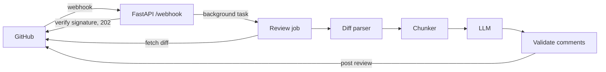

# nitpick

An LLM-powered pull request reviewer. When a pull request is opened or
updated, nitpick reads the diff, asks an LLM to look for bugs, security
issues, performance problems and readability issues, and posts the
findings back to GitHub as inline review comments.


## Why

Small teams and solo developers often merge code that nobody else has
read. nitpick gives every PR a fast first pass so human reviewers can
spend their time on design questions instead of obvious mistakes.

## Status

nitpick runs as a GitHub App and has been tested end to end on a sandbox
repository, receiving webhooks through a smee.io tunnel: first review of
a PR, a skipped duplicate delivery, and an incremental review after a new
commit. Cloud deployment is planned next.

## How it works



| Module | Responsibility |
| --- | --- |
| `diff_parser.py` | Parse unified diff into files, hunks and line numbers |
| `chunker.py` | Filter, prioritise and split files into LLM-sized chunks |
| `reviewer.py` | Call the LLM per chunk, validate and rank comments |
| `jobs.py` | Fetch the PR, run the review, post it (with fallback) |
| `store.py` | SQLite record of reviewed commits (deduplication, incremental reviews) |
| `main.py` | Webhook endpoint: signature check, event filtering |
| `cli.py` | Review a PR from the terminal (dry run by default) |

## Design decisions

- **Respond fast, work in the background.** GitHub treats slow webhook
  responses as failures, so the endpoint returns `202` and the review
  runs as a background task.
- **Verify every webhook.** Requests without a valid
  `X-Hub-Signature-256` are rejected before any LLM call is made.
- **Inline comments only on changed lines.** Comments on unchanged
  context lines are usually opinions about pre-existing code, so they
  go into a collapsible "Notes on unchanged code" section of the summary
  instead. They are kept rather than discarded because a real problem,
  such as a caller left stale by a signature change, often sits on an
  unchanged line.
- **Never trust the LLM's line numbers.** Comments that point at lines
  outside the diff are dropped instead of being sent to GitHub, and the
  number of dropped comments is recorded.
- **Explicit line numbers in the prompt.** Each diff line is rendered
  with its new-file line number so the model does not have to count.
- **Split large diffs instead of truncating them.** Files are split at
  hunk boundaries (and oversized hunks by lines) so nothing is silently
  dropped. Lock files and generated output are skipped.
- **Bounded cost.** A review makes at most `MAX_CHUNKS` LLM calls. When a
  PR is larger than that, source code is reviewed before tests, and tests
  before config and docs; anything left out is listed in the summary.
- **Review each commit once.** GitHub can deliver the same webhook more
  than once. A (repo, PR, head commit) row with a primary key is claimed
  before any LLM call, so concurrent duplicates cannot both proceed.
  Failed or stuck reviews (no update for 15 minutes) can be retried.
- **Incremental reviews.** After new commits are pushed, only the changes
  since the last reviewed commit are reviewed. After a force push or
  rebase the old commit is no longer an ancestor, so the whole PR is
  reviewed again.
- **Pin the reviewed commit.** Reviews are posted against the head SHA
  that was actually reviewed.
- **Degrade gracefully.** One failing LLM call does not stop the review,
  and if GitHub rejects inline positions the findings are posted as a
  single summary comment.
- **Testable core.** Parsing, chunking and reviewing have no HTTP or SDK
  dependencies; tests use a fake LLM and a fake GitHub client.

## Results

Measured with the [evaluation harness](evaluation/README.md): 16 small
PRs (11 with one planted bug, security or performance issue, 3 clean
PRs that should get no comments, and 2 harder cases), each run 3 times
with `gpt-4o-mini`.

| Change | Recall | Strict precision | Inline false positives per clean PR | Large-file case | Cost per review |
| --- | --- | --- | --- | --- | --- |
| Baseline | 92% | 100% | 0.56 | 0/3 | $0.00018 |
| Comments on unchanged lines become notes | 92% | 100% | 0.11 | 0/3 | $0.00018 |
| Hunk-level chunking and review budget | 100% | 100% | 0.00 | 3/3 | $0.00023 |

How to read this honestly:

- **Chunking** is the clearest result. The baseline cut off large files,
  so a bug in the last hunk was never sent to the LLM. Splitting by hunk
  fixed that case (0/3 to 3/3) and changed the chunking of no other
  case. The cost is about 28% more per review on average, because the
  large file now takes two LLM calls.
- **Notes** were evaluated together with a fix to one clean test case,
  so the drop from 0.56 to 0.11 has two causes. The isolated effect is
  on the rename-only PR: inline comments fell from 0.7 to 0.3 per run.
- The drop from 0.11 to 0.00 in the last row is run-to-run variation,
  not an effect of chunking: the clean cases were chunked identically.

## Known limitations

- **The benchmark is saturated.** Every planted issue is now found, so
  this set can no longer show whether a prompt or model change helps.
  Harder cases (longer PRs, subtler bugs, several issues per PR) are
  needed, ideally collected from real reviews.
- **Matching checks location, not content.** A comment on the right line
  counts as a hit even if its suggested fix is wrong. In one run the
  model correctly flagged a weak test but proposed an assertion that
  would itself fail.
- **Opinions about unchanged behaviour can still appear inline.** On a
  rename-only PR the model sometimes comments on existing behaviour and
  attaches the comment to a renamed line, which the changed-lines rule
  cannot distinguish. Fixing this would need semantic checks; it was
  left as is because it happens in about one run in three.
- **Small sample.** 16 cases and 3 runs each; differences of a few
  percent are not meaningful.
- Tokens are estimated as characters / 4 rather than counted exactly.

## Quick start (CLI)

```bash
python3 -m venv .venv
source .venv/bin/activate
pip install -r requirements.txt
cp .env.example .env    # fill in OPENAI_API_KEY and GITHUB_TOKEN
set -a; source .env; set +a

# Dry run: prints the review, posts nothing
python -m nitpick.cli https://github.com/<owner>/<repo>/pull/1

# Post the review to the PR
python -m nitpick.cli https://github.com/<owner>/<repo>/pull/1 --post
```

Use a fine-grained token scoped to a single test repository with
read/write access to Pull requests and read access to Contents.

## Running as a GitHub App

1. Create a GitHub App with permissions *Pull requests: Read & write*
   and *Contents: Read*, subscribed to the *Pull request* event.
2. Set the webhook secret and download the private key.
3. Fill in `GITHUB_APP_ID`, `GITHUB_PRIVATE_KEY_PATH` and
   `GITHUB_WEBHOOK_SECRET`, then run:

```bash
uvicorn nitpick.main:app --port 8000
```

Review history is stored in `NITPICK_DB_PATH` (default `nitpick.db`). In
Docker it lives at `/data/nitpick.db`; mount a volume there so it
survives restarts.

For local testing, expose the port with a tunnel (for example smee.io
or ngrok) and use that URL as the app's webhook URL.

## Tests

```bash
pytest -q
```

## Evaluation

See [evaluation/README.md](evaluation/README.md) for the benchmark of
planted bugs used to measure review quality.

## Roadmap

- [x] Smarter chunking for large PRs (hunk splitting, file priority, review budget)
- [ ] Exact token counting with tiktoken
- [x] Skip work that was already done (idempotent deliveries, review only new changes)
- [x] Evaluation harness with planted-issue cases
- [ ] Evaluation on real pull requests
- [ ] Per-repository configuration file
